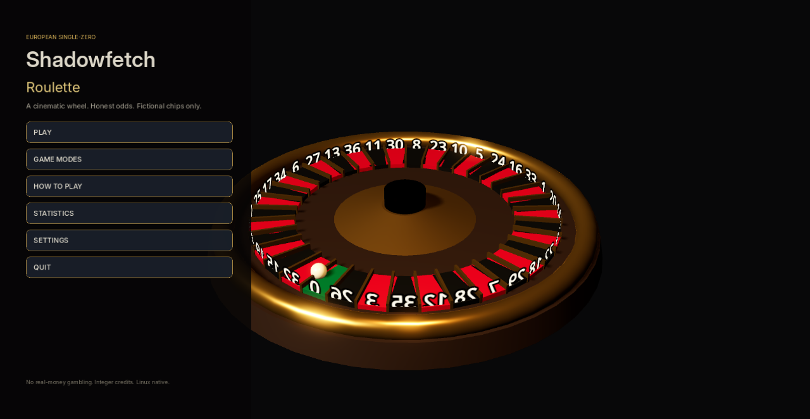
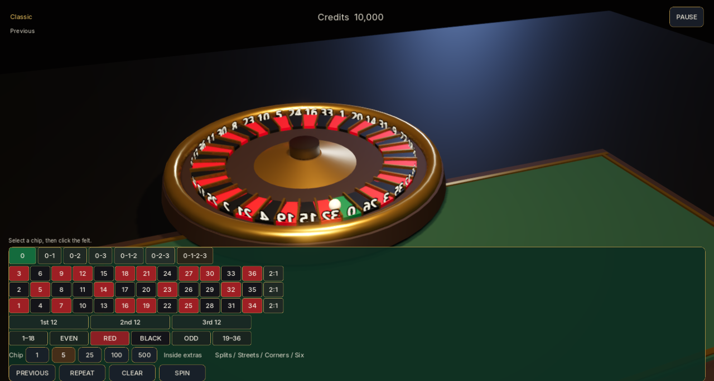

# Shadowfetch Roulette

European single-zero roulette for Linux. A physical 3D wheel, a full betting felt, and a fictional integer bankroll. There is no real-money gambling.

Sibling to the other Shadowfetch desktop games — same dark, cinematic family, not a clone.





## Run

**Exported binary**

```bash
~/.local/bin/shadowfetch-roulette
```

**From Godot (development)**

```bash
godot --path "$HOME/src/ShadowfetchRoulette"
```

Desktop launcher name: **Shadowfetch Roulette**  
Icon: `shadowfetch-roulette` in the hicolor theme.

## Tests

```bash
./tools/run_tests.sh
```

Covers every bet type and payout, 120,000 randomized spin/bet resolutions, bankroll identities, min/max limits, duplicate-settlement rejection, and settings recovery.

## Export and install

Export templates for Godot 4.7.2 must live in the user export-templates directory.

```bash
./tools/export_linux.sh
./tools/install_linux.sh
```

Installs a wrapper to `~/.local/bin/shadowfetch-roulette`, a `.desktop` entry, and hicolor icons (16–512 plus SVG). Super-key launch does not need sudo.

If `rsvg-convert` or `desktop-file-validate` is missing:

```bash
sudo apt install librsvg2-bin desktop-file-utils
```

The game still runs from the exported binary without those packages.

## Rules

- 37 pockets, single zero
- Straight 35:1 · Split 17:1 · Street 11:1 · Corner 8:1 · Six Line 5:1
- Red/Black, Odd/Even, Low/High 1:1 · Dozens and Columns 2:1
- Zero loses every outside bet
- Previous = undo last chip · Repeat = last settled round · Clear = refund live chips

## Modes

Classic, Practice, High Limit, Speed. Odds never change.

## Controls

- **LMB** — place the selected chip
- **Space** — spin
- **Esc** — pause
- **RMB** — orbit
- **Wheel** — zoom
- **H** — reset camera

## Settings

Resolution, fullscreen, vsync, graphics quality, anti-aliasing, shadows, effects, master/music/sfx/ambient volumes, camera sensitivity. Saved locally. Corrupt files restore defaults.

## Data

- Config: `$XDG_CONFIG_HOME/shadowfetch-roulette/settings.json`
- Statistics: `$XDG_DATA_HOME/shadowfetch-roulette/statistics.json`

## Assets

- Inter fonts — SIL Open Font License 1.1 (`assets/fonts/LICENSE-Inter.txt`)
- Meshes, materials, icon, and procedural audio — original to this project

## Privacy

No telemetry. No account. Source and docs do not embed personal paths or machine identifiers.
